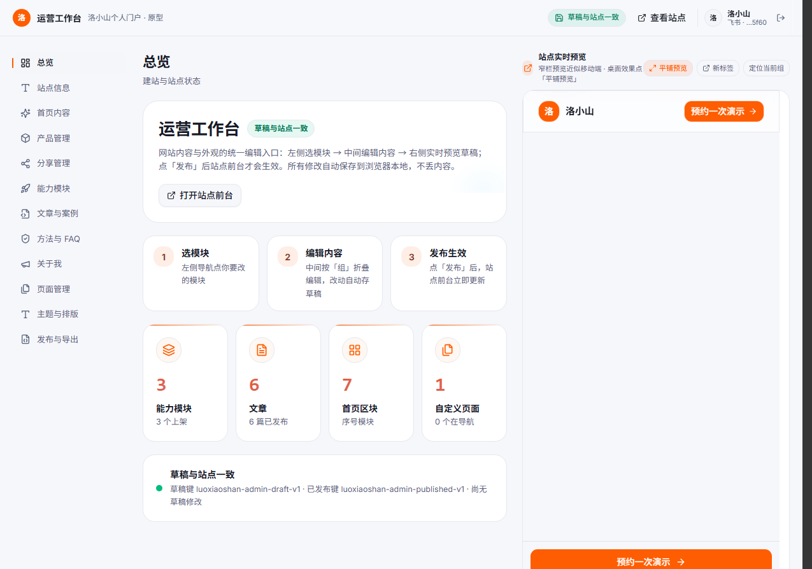
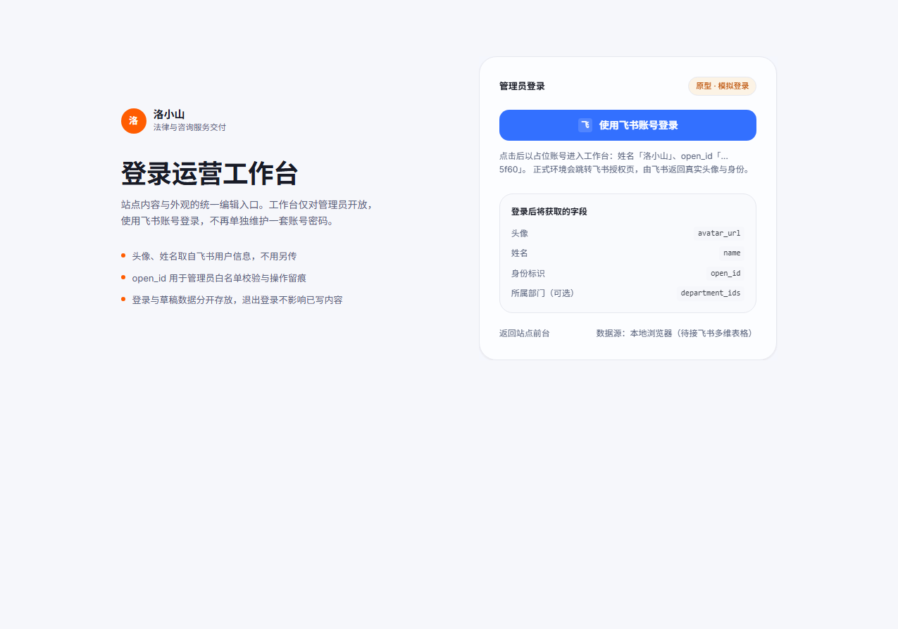
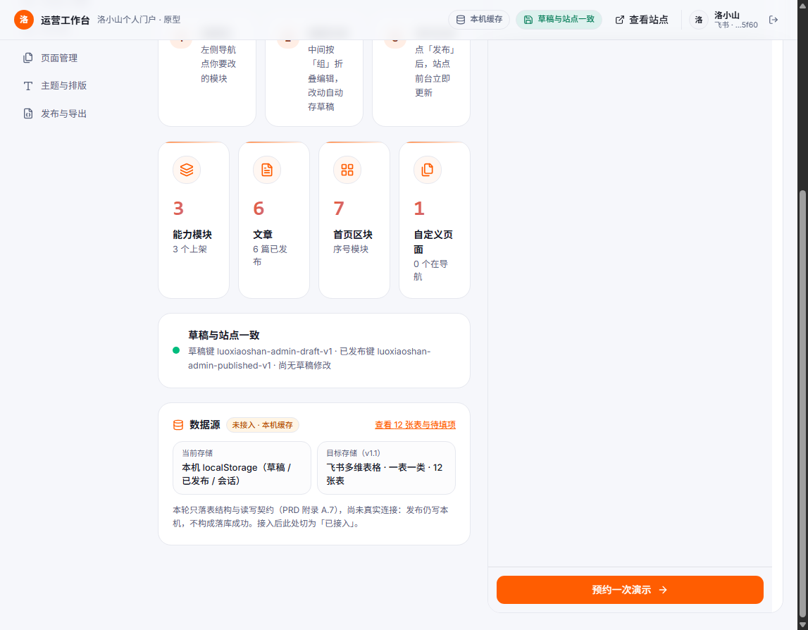

<div align="center">

# HugoW个人专业门户 · 高保真原型

一个人公司式的专业服务门户：前台站点 + 运营工作台 + 飞书多维表格数据契约。<br>
React 19 · Vite 6 · TypeScript 5.7 · Tailwind CSS v4 · shadcn/ui

</div>

---

## 这是什么

这是一个**可运行的 Web 应用原型**，不是一个静态模板。它把「个人专业门户」拆成三件事，并给出各自的实现：

| 角色 | 路径 | 说明 |
| --- | --- | --- |
| 访客看到的站点 | `#/` 及 12 条二级路由 | 首页、能做什么、怎么交付、文章、案例、大家评价、关于我、联系、隐私等 |
| 运营者使用的工作台 | `#/admin/` | 12 个管理栏目，草稿与已发布双层数据，右侧实时预览 |
| 登录入口 | `#/login/` | 飞书账号授权（当前为模拟实现）+ 未登录访问的拦截引导 |

设计目标不是「好看的个人主页」，而是把**专业服务里最重复的部分**沉淀成可交付、可验收的流程资产——所以站点结构围绕服务模块、交付流程、边界声明来组织，而不是围绕个人履历堆砌。

## 在线演示

已通过豆包云（doubao-html）发布，构建产物直接部署、无需服务端：

- 站点前台：https://scnggxoitbu6.doubao.link/app/app_17hjnfbagtw
- 运营工作台（模拟登录）：同一地址的 `#/login/` → `#/admin/`

> 演示环境为原型构建产物，数据存在访客浏览器本地，换设备看到的是初始内容。

## 预览

| 站点前台 | 运营工作台 |
| --- | --- |
|  |  |
| **登录页** | **数据源状态** |
|  |  |

> 截图保存在 docs/screenshots/，由本地运行后截取。

## 功能清单

**站点前台**

- 首页：Bento 区块布局、玻璃拟态卡片、Hero 人设区、数字条、服务模块、交付流程、演示面板、客户证言、文章与分享
- 11 种可组合区块类型：`hero` `stats` `cards` `text` `faq` `timeline` `cta` `columns` `gallery` `pricing` `testimonials`
- 10 套主题包（配色与排版令牌），一键切换整站视觉
- HashRouter 路由，纯静态托管即可运行，无需服务端

**运营工作台**

- 12 个管理栏目：总览 / 站点信息 / 首页内容 / 产品管理 / 分享管理 / 能力模块 / 文章与案例 / 方法与 FAQ / 关于我 / 页面管理 / 主题与排版 / 发布与导出
- **草稿 / 已发布双层数据**：编辑先写草稿，发布后前台才生效；两个作用域独立存储
- 分组可折叠的内容编辑器，字段级修改即存即生效
- 右侧实时预览面板：滚动定位、区块高亮、全屏平铺
- 发布前差异检查与二次确认，支持单切片重置
- 页面管理：新建自定义页面、导入 JSON、区块编排
- 数据源状态面板：明确区分「本机缓存」与「飞书多维表格（未接入）」

**认证**

- 未登录访问 `#/admin/*` 会被拦截并引导到 `#/login/?next=...`
- 会话 12 小时过期，`localStorage` 键 `hugow-admin-session-v1`
- 当前为**模拟登录**（`source: "mock"`），页面明确标注「原型 · 模拟登录」；真实飞书 OAuth 的接入点已在代码中预留

## 技术栈

| 层 | 选型 |
| --- | --- |
| 框架 | React 19 + TypeScript 5.7 |
| 构建 | Vite 6（`tsc -b && vite build`） |
| 样式 | Tailwind CSS v4（`@tailwindcss/vite`，CSS 变量驱动主题） |
| 组件 | shadcn/ui 风格 + Radix UI 原语 + lucide-react 图标 |
| 路由 | react-router-dom 7（HashRouter，静态托管友好） |
| 动效 | motion（局部转场与卡片入场） |

## 快速开始

要求 **Node.js ≥ 22.6**（构建 ≥ 20 即可，但 `test:*` 依赖 `node --experimental-strip-types`，需要 22.6+）。

```bash
npm install
npm run dev          # 默认 http://localhost:5173
npm run build:all    # 类型检查 + 双产物：dist/（访客）+ dist-admin/（管理台）
npm run preview      # 预览构建产物
npm run typecheck    # 只做类型检查
npm run verify       # 双产物构建 + 4 组测试 + 文案/资源红线检查 + 冒烟
```

Windows 提示：npm 的原生依赖按平台下载，请在目标机器上执行 `npm install`；从 Linux 容器拷贝的 `node_modules` 会因缺少 `win32-x64` 原生包而报 `Cannot find module @rollup/rollup-win32-x64-msvc`。

## 目录结构

```
src/
├─ main.tsx                 应用入口
├─ App.tsx                  应用装配
├─ index.css                Tailwind v4 入口 + 设计令牌 + 玻璃拟态基座
├─ components/ui/           shadcn 风格基础组件（button、dialog、sheet 等）
├─ lib/utils.ts             class 合并等工具
└─ site/
   ├─ SiteApp.tsx           站点路由装配：前台 / 工作台 / 登录 / 404
   ├─ data/                 内容数据（改这里就是改站点内容）
   │  ├─ home.ts            首页 Hero、数字条、区块配置
   │  ├─ solutions.ts       服务模块（能力卡片）
   │  ├─ products.ts        产品卡
   │  ├─ writing.ts         文章与案例
   │  ├─ method.ts          交付流程、价格、FAQ
   │  ├─ about.ts  site.ts  关于我、导航、页脚、联系
   │  ├─ pages.ts           自定义页面注册表
   │  └─ themes.ts          10 套主题包令牌
   ├─ pages/                13 个页面组件 + DynamicPage 通用渲染器
   ├─ components/           Header、Footer、Hero、演示、分享等区块组件
   └─ admin/
      ├─ store.tsx          草稿/发布双层数据、深合并、发布与重置
      ├─ auth.tsx           会话层 + 未登录拦截门
      ├─ bitable.ts         飞书多维表格契约（12 张表 + 环境空位）
      ├─ AdminPage.tsx      12 栏工作台
      ├─ forms.tsx          通用分组表单编辑器
      └─ PageManager.tsx    页面与区块管理
```

## 配置说明

**改内容**：只改 `src/site/data/*.ts`，不要动组件。每个文件顶部都有类型定义，字段改名会立刻被 TypeScript 拦下。

**改主题**：`src/site/data/themes.ts` 中是 10 套主题令牌（主色、辅色、圆角、字体栈）。工作台「主题与排版」可直接切换，切换后通过 CSS 变量注入全站生效。

**改路由**：`src/site/SiteApp.tsx` 是统一的路由装配点，新增页面需同时登记到 `src/site/data/pages.ts`。

**接入飞书**：`src/site/admin/bitable.ts` 预留了三个空位，填齐后 `bitableReady()` 返回 true，工作台的数据源状态会自动从「本机缓存」变为「飞书多维表格」：

```ts
export const BITABLE_ENV = {
  appToken: "",      // 多维表格 Base 的 app_token
  gateway: "",       // 你的薄网关地址，如 https://api.example.com
  callbackUrl: "",   // 飞书应用后台登记的回调地址
};
```

`app_secret` **不放在这里**。换 token 必须发生在服务端，前端只拿网关签发的会话。

## 飞书接入现状（重要）

当前仓库里飞书能力是**契约层**，不是已接入状态：

- 12 张表的结构与切片映射已冻结（`BITABLE_TABLES`），与本项目设计文档中的表结构逐条对齐
- `pullAll()` / `pushAll()` 在未接入时统一返回 `ok: false`，调用方自动回落本机存储，不会静默丢数据
- 真实接入需要四件事：域名 + HTTPS（回调地址在飞书应用后台登记）、一个持有 `app_secret` 的薄网关、多维表格授权给应用、各表 `table_id`

网关已实现的路由（`src/server/gateway.ts`，平台无关处理函数，含单元测试）：

```
GET  /api/health           健康检查与请求计数
GET  /api/auth/callback    飞书授权回跳：换票 → 白名单 → 建会话 → 302 回工作台（Set-Cookie）
POST /api/auth/exchange    前端直连换会话（同一套换票逻辑，返回 JSON）
GET  /api/auth/me          校验会话，返回 name / avatar / open_id 尾号
POST /api/auth/logout      清会话、清 Cookie
POST /api/publish          发布草稿（会话鉴权 + 按管理员限流 + 单实例串行锁）
GET  /api/snapshot/current 读取发布快照
```

> 网关的 Node HTTP 入口（`src/server/main.ts`，监听 `127.0.0.1:8787`）**尚未提交**，属部署前必补项；
> 处理函数与测试已就绪。

## 构建与部署

```bash
npm run build:site   # 访客站 → dist/
npm run build:admin  # 管理台 → dist-admin/（含 index.html）
```

部署要点：

- 正式形态是**单机自托管**：一台云主机上 Nginx 双 vhost，`www` 服务 `dist/`、`admin` 服务 `dist-admin/` 并反代 `/api`；**不接 CDN、不接对象存储**
- 网关是同机 Node 进程（systemd，`127.0.0.1:8787`），只服务管理台的 `/api`
- HashRouter 由前端处理路由，但服务端仍需 SPA 回退（所有路径回落 `index.html`）
- `index.html` `no-cache`，`assets/*`（带内容 hash）长缓存；发布快照写本机 `/srv/hugow/data`
- 若启用飞书登录，`admin` 与 `/api` 必须同域，Cookie 才能生效

## 已知限制

这是原型，不是生产系统，以下问题如实记录：

- 数据默认存本机 `localStorage`，换浏览器或清缓存即丢失；多人协作需要接入多维表格或数据库
- 登录为模拟实现，未接真实飞书 OAuth；`MOCK_USER` 的 `open_id` 是占位值
- 仓库中没有真实客户案例与证言，样例为演示文案
- 图片已本地化为站内 webp（头像三档 + 背景），不再依赖外链图床
- 访客产物与工作台产物已拆分，入口块 gzip 约 30 kB，AdminPage 只在 `dist-admin`
- 自动化验证覆盖到冒烟级：`scripts/smoke.mjs`（Playwright，路由可达、双入口隔离、登录拦截、图片加载），更完整的 E2E（真实授权回调链路）待网关部署后补

## 内容与合规

站点文案有一条明确的边界：不承诺案件结果、胜诉率、咨询成效，不写「保证」「100%」「零风险」这类表述。专业意见的最终出具由执业人员复核确认。这条规则同样适用于二次开发——如果要做同类站点，请保留边界声明。

## Roadmap

- [ ] 真实飞书 OAuth + 薄网关（七条路由与 27 项单测已就绪；仍缺 `main.ts` 入口、真实 `FeishuClient`、工作台登录切换与单机部署）
- [ ] 多维表格双向同步与冲突处理（当前为单向覆盖；`FeishuAdapter` 尚未实现）
- [x] 路由级代码拆包（访客/管理台双入口）
- [x] Playwright/k6 冒烟与压测脚本（登录、发布、未登录拦截、并发基线；k6 尚未在真实云主机执行）
- [ ] 图片上传落本机 `/srv/hugow/media` 并纳入每日备份（不使用对象存储直传）

## License

[MIT](./LICENSE) © 2026 HugoWorld

站点中的示例文案、客户证言与人物形象仅用于演示，不代表真实业务承诺。
