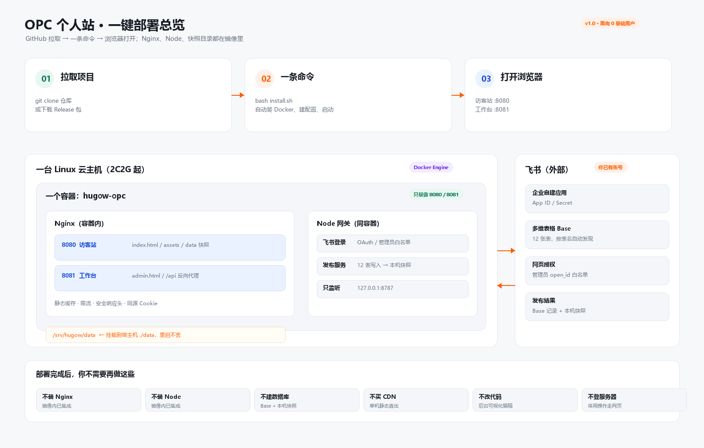
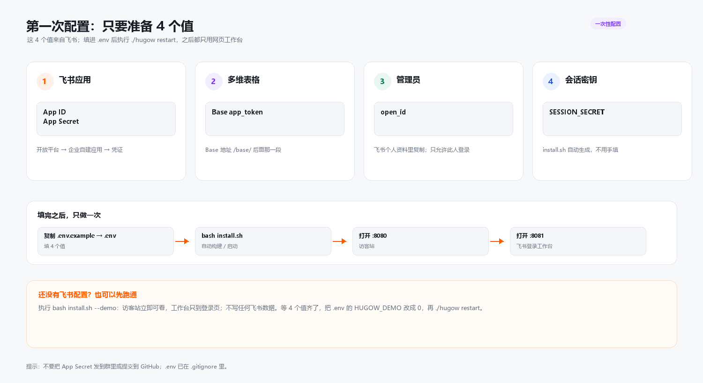

# OPC 个人站 · 一键部署版

面向**律师、顾问、独立开发者等 0 基础非 IT 人群**的个人专业门户：
访客站 + 可视化工作台 + 飞书多维表格数据 + 本机快照。

不需要买 CDN、不需要对象存储、不需要数据库，也不需要登录服务器改内容。
一台 2C2G Linux 云主机，一条命令，浏览器打开就能用。

> **部署前必读（两个高频误解）**
>
> 1. **飞书账号必须是企业/团队租户账号。** 个人版账号、未加入企业租户的账号，无法正常创建企业自建应用，扫码登录会报“无权限”或 `21001`；扫码还要求管理员 `open_id` 在 `ADMIN_OPEN_IDS` 白名单且应用可见范围包含本人。
> 2. **安装脚本不会自动创建多维表格，也不会自动创建 12 张表。** 需要先准备一个包含 12 表的 Base（推荐复制模板），并把飞书应用加入 Base 文档应用。工作台向导里的“逐张核对 / 自动补齐缺失表”只是界面演示，不会真正调用建表接口。
>
> 完整检查清单见 [`docs/product/部署与运营注意事项.md`](docs/product/部署与运营注意事项.md)，日常操作见 [`docs/product/用户使用手册.md`](docs/product/用户使用手册.md)。

> 先看效果（豆包静态访客站，不含登录/发布）：<https://scnggxoitbu6.doubao.link/app/app_17htfakm32k>



## 3 步跑起来

### 第 1 步：准备一台 Linux 云主机

- Ubuntu 22.04 / 24.04 或 Debian 12
- 2 vCPU / 2 GB 内存 / 20 GB 磁盘（个人站足够）
- 能访问 GitHub 与 Docker Hub；安全组放行 `8080`、`8081`

### 第 2 步：拉取并执行

```bash
git clone https://github.com/HugoWorld/OPC-site.git
cd OPC-site
bash install.sh
```

脚本会自动：检查/安装 Docker → 生成 `.env` 与会话密钥 → 构建镜像 → 启动 Nginx + Node 网关 → 健康检查。
首次 3~8 分钟，取决于网络。

### 第 3 步：打开浏览器

- 访客站：`http://服务器IP:8080`
- 工作台：`http://服务器IP:8081`

如果只想先看访客站、暂时不接飞书：

```bash
bash install.sh --demo
```

演示模式不校验飞书凭据，访客站可直接浏览；工作台登录页有「进入演示工作台」按钮，可预览完整工作台，数据只写本机 `data/`，不写飞书。

## 第一次配置：只要 4 个值



| 值 | 从哪里来 | 写到 `.env` |
|---|---|---|
| App ID / App Secret | 飞书开放平台 → 企业自建应用 → 凭证与基础信息 | `FEISHU_APP_ID` / `FEISHU_APP_SECRET` |
| Base app_token | 多维表格 URL 中 `/base/` 后面那一段 | `BITABLE_APP_TOKEN` |
| 管理员 open_id | 飞书个人资料；只允许这个人登录工作台 | `ADMIN_OPEN_IDS` |
| 会话密钥 | `install.sh` 自动生成；也可 `openssl rand -hex 32` | `SESSION_SECRET` |

填完把 `HUGOW_DEMO=0`，执行：

```bash
./hugow restart
```

> 飞书网页授权要求回调地址是 HTTPS 域名。正式启用登录前，需要把域名解析到服务器，
> 并在飞书后台把 `https://你的域名/api/auth/callback` 登记为重定向 URL。
> 本地 `http://127.0.0.1:8081` 只用于部署自检，飞书一般不允许作为正式回调。

## 它到底装了什么

| 层 | 实现 | 你需要管吗 |
|---|---|---|
| 入口 | 容器内 Nginx：8080 访客、8081 工作台、`/api` 反代 | 不用 |
| 应用 | Node 网关：飞书 OAuth、12 表发布、快照、限流 | 不用 |
| 数据 | 飞书多维表格 + 宿主机 `./data` 快照 | 不用 |
| 部署 | Dockerfile + compose + `install.sh` | 一条命令 |
| 升级 | `./hugow upgrade`（镜像模式自动 pull；源码模式 git pull + 重建） | 一条命令 |
| 备份 | `./hugow backup`（打包 `data/`） | 一条命令 |

### 镜像方式（可选）

GitHub Actions 在 `main` 分支推送后自动构建镜像，已公开发布到 GHCR：

```bash
git clone https://github.com/HugoWorld/OPC-site.git
cd OPC-site
bash install.sh --image
```

镜像名：`ghcr.io/hugoworld/opc-site:latest`（公开仓库，无需 `docker login`）。
首次拉取约 1~2 分钟；镜像内已包含 Nginx、Node 网关、双端静态产物和入口脚本。

## 工作台怎么用

1. 打开 `http://服务器IP:8081`，用飞书扫码登录（需在 `ADMIN_OPEN_IDS` 白名单）；扫码不可用时可切「账号密码」，账号/密码见安装结束打印或服务器 `.env` 的 `ADMIN_LOGIN_USER` / `ADMIN_LOGIN_PASSWORD`。
2. 左侧 12 个栏目：站点信息、首页内容、产品、分享、能力模块、文章、方法 FAQ、关于我、页面、主题、发布。
3. 改内容先写**草稿**，右侧实时预览；点「发布」才写入飞书 Base 并生成本机快照，访客站随即更新。
4. 发布失败不会切换当前快照，访客继续看到上一版完整内容。

## 12 张表与可复制性

项目使用 12 张飞书多维表格：`site_config`、`home_blocks`、`solutions`、`articles`、`products`、`shares`、`pages`、`method_faq`、`about`、`theme`、`samples_testimonials`、`audit_log`。

- 表 ID **不再写死**：启动后按表名自动发现 `table_id`，复制模板 Base 后不需要改代码。
- 表名必须与代码中的 12 个英文名一致；字段清单见 [`docs/product/12表字段清单.csv`](docs/product/12表字段清单.csv)。
- 找不到表时，发布会返回 `TABLE_NOT_FOUND`，并提示检查 Base 是否复制完整、应用是否加入文档应用。

> 当前版本仍需要你准备一个包含这 12 张表的 Base。自动建表是下一阶段能力，不在本版承诺内。

## 常用命令

```bash
./hugow status     # 容器状态 + 健康检查
./hugow logs       # 实时日志
./hugow restart    # 改完 .env 后重启
./hugow backup     # 备份 data/ 快照
./hugow upgrade    # 拉取新版本；镜像模式自动 pull，源码模式重建
./hugow upgrade --image  # 强制按 GHCR 镜像升级
./hugow stop       # 停止
```

## 常见问题

| 现象 | 原因 | 处理 |
|---|---|---|
| `install.sh` 装 Docker 失败 | 服务器无法访问 `get.docker.com` 或没有 root | 手动装 Docker 后执行 `bash install.sh --no-docker-install` |
| 8080/8081 打不开 | 安全组/防火墙未放行 | 放行端口；或改 `.env` 的 `HUGOW_WWW_PORT` / `HUGOW_ADMIN_PORT` |
| 登录报 `20029` | 飞书回调地址与 `.env` / 后台登记不一致 | 三处改成同一个 HTTPS 地址；本地 http 不作为正式回调 |
| 登录报 `21001` | 飞书平台策略拒绝应用换 token | 开放平台侧处理；不是代码问题 |
| 发布报 `TABLE_NOT_FOUND` | Base 缺表或表名不一致 | 核对 12 个表名；应用加入 Base 文档应用 |
| 登录后立刻掉线 | HTTPS 下 `COOKIE_SECURE=false` 或 HTTP 下为 `true` | 正式 HTTPS 设 `true`；本地 http 设 `false` |
| 发布后访客没变化 | 浏览器缓存或发布失败 | 刷新；查 `./hugow logs` 与 `/api/health` |

## 安全边界

- App Secret 只存在服务器 `.env`，不进前端、不进 Git；`.env` 已被 `.gitignore` 忽略，`install.sh` 会设为 `600`。
- 网关只监听 `127.0.0.1:8787`，公网只能经 Nginx。
- 工作台登录走飞书 OAuth，`ADMIN_OPEN_IDS` 是唯一白名单。
- 会话用 HttpOnly Cookie；发布接口有管理员限流与单实例互斥。
- 站点文案不承诺案件结果、胜诉率、咨询成效；二次开发请保留边界声明。

## 开发者

```bash
npm ci
npm run dev          # 本地开发
npm run build:all    # 双产物：dist/ + dist-admin/
npm run verify       # 类型、测试、同步、文案、资源、冒烟
```

仓库结构、原生 Nginx + systemd 部署、证书与备份见 [`deploy/README.md`](deploy/README.md)。
0 基础逐步操作见 [`docs/product/部署指南-v1.0.md`](docs/product/部署指南-v1.0.md)。
部署前检查与运营注意事项见 [`docs/product/部署与运营注意事项.md`](docs/product/部署与运营注意事项.md)。
日常操作见 [`docs/product/用户使用手册.md`](docs/product/用户使用手册.md)。
产品化阶段评审与问题记录见 [`docs/product/阶段评审-v1.0.md`](docs/product/阶段评审-v1.0.md)。

## License

[MIT](./LICENSE) © 2026 HugoWorld

站点中的示例文案、客户证言与人物形象仅用于演示，不代表真实业务承诺。
